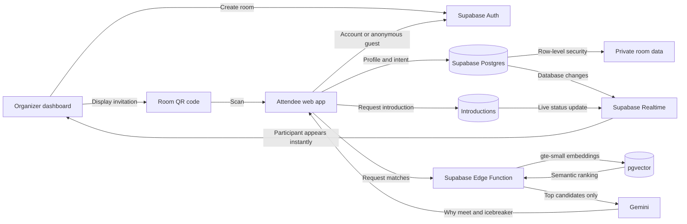

# MissedConnection — Hackathon demo story

## One-line pitch

MissedConnection turns a crowded event into a live, private matching room: attendees scan one QR code, describe what they can offer and need, and immediately discover the people they should meet—with a useful reason and an opening question.

## Architecture

## Why Supabase matters

- **Auth:** organizers use an account; attendees can enter quickly with an account or anonymous guest session.
- **Postgres + RLS:** rooms, profiles, private contact details, and introductions are protected at the database layer.
- **Realtime:** a participant appears on the organizer dashboard as soon as they join; introduction status updates reach both people live.
- **Edge Functions:** `match-room` keeps matching logic and API secrets off the browser.
- **pgvector + Supabase AI:** `gte-small` embeddings rank profiles by meaning, not only identical keywords.
- **Gemini:** writes the human-friendly “why you should meet” and a specific icebreaker. Matching still works if Gemini is unavailable.

## Two-minute live demo

1. **0:00 — Problem:** “At a busy event, the best person for you may be in the room, but you never find each other.”
2. **0:15 — Organizer:** Sign in, create a room, and show the generated QR code.
3. **0:35 — Attendee:** Scan the QR on a second phone, choose guest mode, and enter a short profile. For a job seeker, select “I’m looking for work” and enter the target role.
4. **0:55 — Realtime moment:** Keep the organizer dashboard visible. The attendee’s name appears without refreshing.
5. **1:10 — AI moment:** On the attendee phone, open the recommended match and show the semantic score, explanation, and icebreaker.
6. **1:30 — Connection:** Send an introduction request; accept it on the second account. Show the meeting point and permitted contact exchange.
7. **1:50 — Architecture:** “Supabase powers the full loop—identity, protected data, realtime presence, Edge Functions, and pgvector. Gemini explains the result; it does not own the matching system.”

## Judge-friendly technical answer

> We first apply hard safety and availability filters inside the room. The Edge Function embeds each attendee’s offers and needs with Supabase AI, stores the vectors in Postgres using pgvector, and performs reciprocal semantic ranking. Gemini receives only the shortlisted profile facts to generate a concise explanation and icebreaker. Those explanations are cached, while Row Level Security controls who can see profiles, introductions, and contact details.

## Reliable demo setup

- Use two browsers or one normal window plus one incognito window so the organizer and attendee have separate sessions.
- Prepare two complementary profiles, such as “Hiring a React developer” and “Looking for a frontend role; React and TypeScript.”
- Open the organizer dashboard before submitting the attendee profile so the realtime update is visible.
- Keep the room code copied as a fallback if the venue camera or network makes QR scanning slow.
- If Gemini is slow, continue with the semantic matches—the product intentionally has a deterministic explanation fallback.

